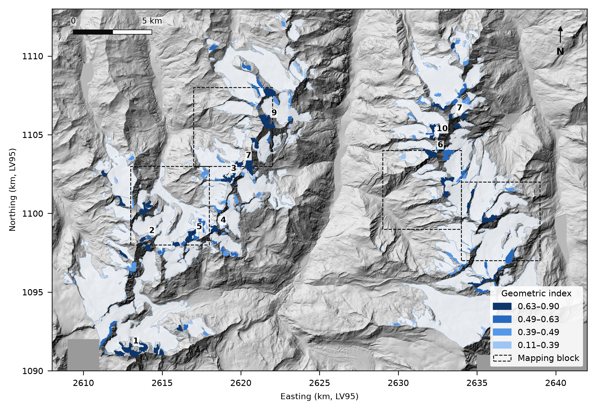

# Hanging glaciers of the Mischabel–Weisshorn massif (Valais)

A short study, made in November 2026 for a PhD application (ICEFAL project, VAW–ETH Zurich / WSL).

**Question.** Can a classifier trained on a manual mapping detect the hanging glaciers of a massif, including
those contained in larger inventory outlines, and rank them by a geometric index?

**Main results** (details in [`report/report.md`](report/report.md)):

- A random forest using only terrain variables (swissALTI3D, SGI2023 outlines) reaches an average precision of
  0.43 in leave-one-block-out cross-validation on the blind manual mapping (random classifier: 0.044), and 0.75
  once the hanging glaciers missed by the mapping are added to the labels.
- The area of the inventory unit is a shortcut ("small unit = hanging"): it is left out so that hanging parts of
  large glaciers are found (9 of 12 instead of 1 of 12).
- 151 candidates over the massif (8.6 km²); in a random sample outside the mapped blocks, 18 of 22 were confirmed
  as hanging glaciers on orthophotos (precision 0.82, 95 % interval 0.61–0.93).
- The thermal state of the candidates (cold or temperate base) is not assessed: a 1D heat model was tried and
  dropped, as terrain data alone cannot tell it apart.



## Repository layout

| Folder | Content |
|---|---|
| `src/` | Reusable functions and processing scripts |
| `notebooks/` | Numbered analyses, run in order (`01_` … `05_`) |
| `data/raw/` | Downloaded data (not versioned) and the manual mapping (versioned, see below) |
| `data/processed/` | Clipped and derived data (not versioned, rebuilt by the scripts) |
| `figures/` | All figures, produced by scripts or notebooks |
| `report/` | Report draft, mapping protocol, candidate table, Overleaf export |

The only versioned data are the manual work, which cannot be rebuilt:

- `data/raw/manual_mapping.gpkg`: hanging glaciers mapped in four 5 × 5 km blocks (`source = initial`: blind
  mapping; `source = review`: added after the review of the false alarms). Protocol: `report/mapping_protocol.md`.
- `data/raw/false_alarms_review.gpkg`: verdicts on the false alarms of the cross-validation.
- `data/raw/candidates_review.gpkg`: verdicts on candidates checked on the orthophotos.

## Reproducing the results

```bash
conda env create -f environment.yml
conda activate icefal
```

Data to fetch (not in the repository):

- **SGI2023** (GLAMOS, release 2026, doi:10.18750/inventory.2023.r2026): shapefiles in `data/raw/sgi2023/`.
- **swissALTI3D** (swisstopo, 2 m): `python src/download_swissalti3d.py` (about 760 tiles, ~0.8 GB).
- **glenglat** (borehole locations, shown on the maps): clone https://github.com/mjacqu/glenglat into
  `data/raw/glenglat`.
- SWISSIMAGE was only viewed in QGIS as a WMTS stream (`ch.swisstopo.swissimage`), not downloaded.

Then, from the project root:

```bash
python src/prepare_sgi.py        # whole SGI2023 glaciers within the study extent
python src/prepare_dem.py        # 10 m DEM (exact mean of the 2 m tiles)
python src/prepare_relief.py     # slope
python src/prepare_features.py   # classifier inputs and labels
# notebooks 01 to 05, in order
python src/make_report_figures.py
```

The manual work in QGIS is already done and its results are versioned in `data/raw/`. The layers it used were
built by `src/prepare_mapping_kit.py` (mapping kit), `src/prepare_false_alarm_review.py` (after notebook 03) and
`src/prepare_candidate_review.py` (after notebook 05); each takes the output folder as argument.

Study extent (LV95, EPSG:2056): E 2,608–2,642 km, N 1,090–1,113 km (`src/config.py`).

## Data sources

- GLAMOS (2026). Swiss Glacier Inventory 2023 (SGI2023). doi:10.18750/inventory.2023.r2026
- swisstopo: swissALTI3D (2024) and SWISSIMAGE (2023), open data.
- Beer, J., Jacquemart, M., Huss, M., et al. (2026). *The Cryosphere* 20, 5453–5473. doi:10.5194/tc-20-5453-2026
